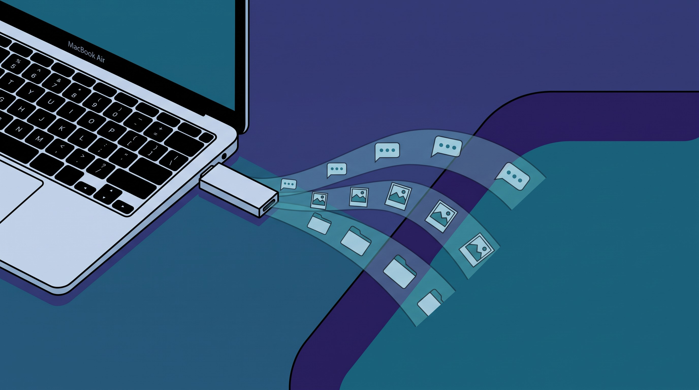

# Overflow

**Your Mac's spare room.** Overflow moves cold data from a Mac's internal disk to an
external volume (a USB-C stick that stays plugged in, or any SSD) on a weekly schedule,
leaves symlinks so nothing breaks, and shows free space in the menu bar.

Built for the way AI-assisted development fills a laptop: multi-GB session transcripts,
generated images, and per-task project copies that are never opened again.



- Brochure: [marketing/overflow-brochure.pdf](marketing/overflow-brochure.pdf)
- Requirements: macOS 13 or later, Xcode command line tools (`xcode-select --install`) to build the menu bar app.
- No dependencies. Four files do all the work.

## What's in the box

| Path | What it is |
|---|---|
| `bin/overflow-archive.sh` | The archive script. Dry run by default, `--run` to move. Reads `config.zsh`. |
| `config.example.zsh` | Sources and thresholds. Copied to `~/Library/Application Support/Overflow/config.zsh` on install. |
| `launchd/com.overflow.archive.plist` | Weekly job, Sundays 03:00. Skips silently when the volume is not mounted. |
| `app/` | Overflow Monitor, the menu bar app (single-file Swift, AppKit). `app/build.sh` compiles it into `/Applications`. |
| `install.sh` / `uninstall.sh` | Put everything in place, or take it all out. |
| `marketing/` | Brochure HTML/PDF and artwork. |

## How it works

Two kinds of sources, both listed in `config.zsh`:

**File sources** (`FILE_SOURCES`, `"dir|days"`): every file older than N days is moved
individually, keeping its path relative to `$HOME`. No symlink. Good for transcript logs,
generated images, caches.

**Folder sources** (`FOLDER_SOURCES`, `"dir|days"`): each top-level subfolder is moved
whole once it has been idle for N days, and a symlink is left at the original path so tools
keep working while the volume is connected. A subfolder is idle when no file **under 1 MB**
has been modified in N days. Big media is ignored on purpose: copies made with `cp -p` or
APFS clones inherit misleading timestamps, while the files you actually edit (source, JSON,
markdown) are small. Subfolders that contain a `.git` directory never move, and neither do
names listed in `FOLDER_KEEP`.

Layout on the volume mirrors the laptop:

```
Laptop                                        /Volumes/Overflow
~/.codex/sessions/2026/09/…/x.jsonl    →      .codex/sessions/2026/09/…/x.jsonl       (older than 30 days)
~/.codex/generated_images/…/y.png      →      .codex/generated_images/…/y.png         (older than 30 days)
~/Projects/Advanced Content/<task>/    →      Projects/Advanced Content/<task>/       (idle 14 days, symlink left)
```

Safety rules, in order of importance:

1. **Marker file.** The script refuses to run unless `$DEST/.overflow-stick` exists, so it
   can never write into an empty mount point or the wrong drive. `install.sh` creates it.
2. **Verify, then delete.** Files are copied, compared with `cmp`, then removed. Folders are
   copied with `rsync -a` and re-checked with `rsync --checksum`. A failed check keeps the
   original and logs `FAILED`.
3. **Dry run by default.** Only `--run` moves anything. Every real run is logged to
   `$DEST/_archive-log.txt`.
4. **Nothing on the volume is backed up by Overflow.** Only put reproducible or
   OK-to-lose data in your sources. Eject before unplugging.

## Install

```sh
# 1. Format a stick as APFS named "Overflow" (Disk Utility, or:)
diskutil list external                      # find the stick, e.g. disk4
diskutil eraseDisk APFS Overflow GPT disk4  # DESTROYS everything on that disk

# 2. Install
git clone https://github.com/danmarai/overflow.git && cd overflow
./install.sh

# 3. Pick your sources
open -t ~/Library/Application\ Support/Overflow/config.zsh

# 4. Try it
zsh ~/Library/Application\ Support/Overflow/overflow-archive.sh          # preview
zsh ~/Library/Application\ Support/Overflow/overflow-archive.sh --run    # move
```

Then click the drive icon near the clock and turn on **Start at login**.

`install.sh` is idempotent: re-run it after pulling updates. It keeps your `config.zsh`.
Set `SKIP_LAUNCHD=1` to install everything except the weekly job.

## The menu bar app

Overflow Monitor shows internal free space next to the clock. The icon turns orange under
15 GB and red under 8 GB, and shows a crossed-out drive when the volume is not mounted.
The menu lists the volume, each folder source (local vs archived counts), the last run and
whether the weekly job is loaded, with actions to preview or run an archive (normal, or
with a 7-day folder threshold), open the log, reveal or eject the volume, and toggle
start-at-login. It reads its configuration from the script (`--print-config`), so there is
one source of truth.

Rebuild after editing `app/main.swift`: `zsh app/build.sh`.

## One-off runs

```sh
FOLDER_DAYS=7 overflow-archive.sh --run        # more aggressive folder threshold this run
FILE_DAYS=14  overflow-archive.sh --run        # same for file sources
OVERFLOW_CONFIG=/path/to/other.zsh overflow-archive.sh
```

## Restore something

```sh
# a file
rsync -a "/Volumes/Overflow/.codex/sessions/<path>" ~/.codex/sessions/<path>
# a folder (remove the symlink first)
rm ~/Projects/Advanced\ Content/<task>
rsync -a "/Volumes/Overflow/Projects/Advanced Content/<task>/" ~/Projects/Advanced\ Content/<task>/
```

## Uninstall

`./uninstall.sh` removes the job, the app and the support folder. Data on the volume and the
symlinks pointing to it are left alone.

## Known limits

- Symlinked folders are unreachable while the volume is unplugged. Tools that reject
  symlinks (some export scripts) will skip them; restore the folder if you need it live.
- The menu bar item can be hidden by the notch on a crowded menu bar. The app asks macOS
  to place it next to the system icons on first launch; Cmd-drag it anywhere after that.
- Apple Silicon build target. For Intel, change `-target` in `app/build.sh`.

## License

MIT. See `LICENSE`.
